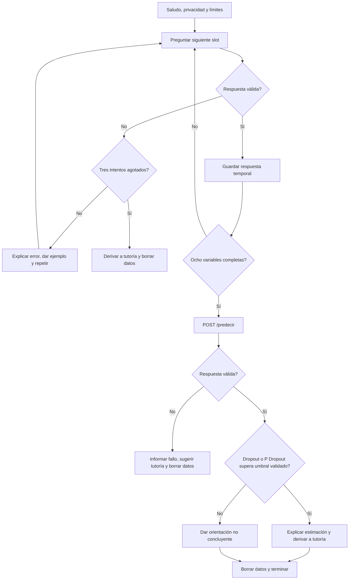

# Diagrama E6 — Chatbot de reglas

La comparación probabilística solo se realiza si E4 proporciona un umbral validado; sin umbral, se informa la limitación y se aconseja revisión por tutoría. No se almacenan nombres, DNI ni respuestas tras finalizar.
